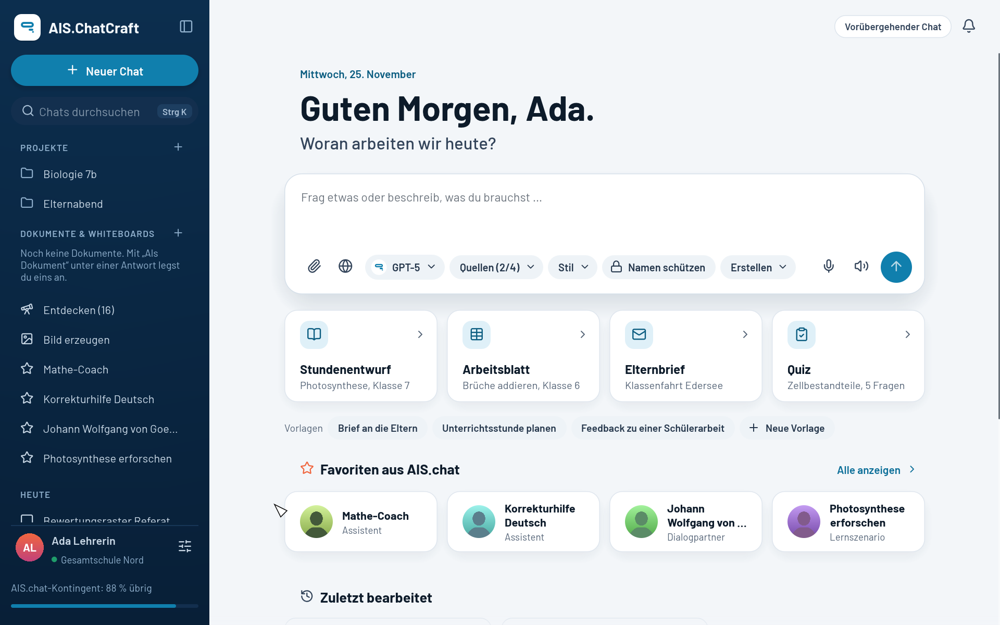
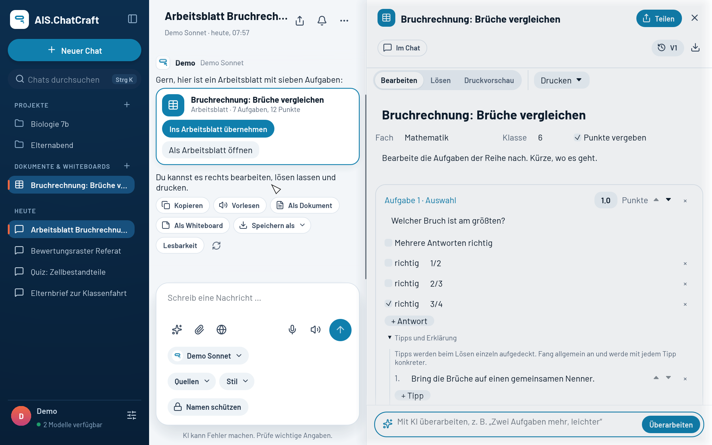
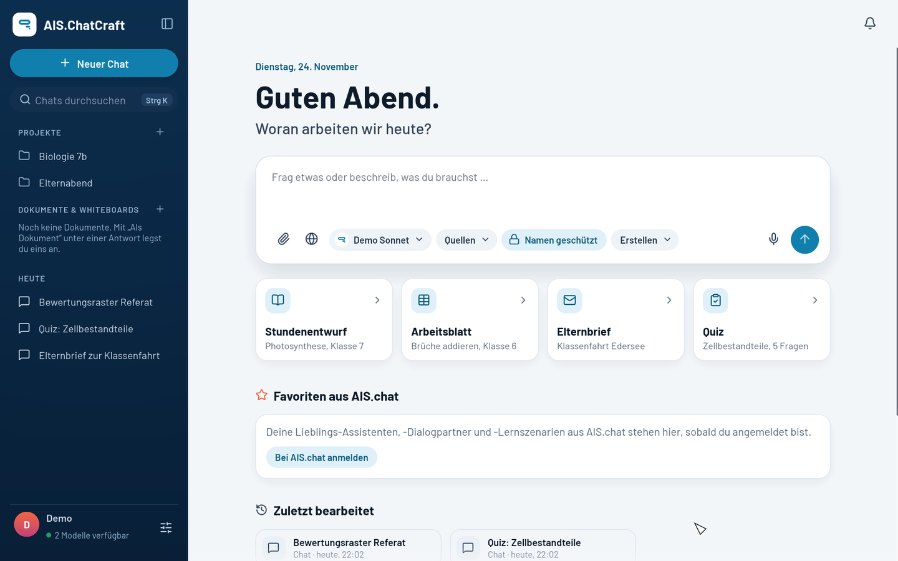
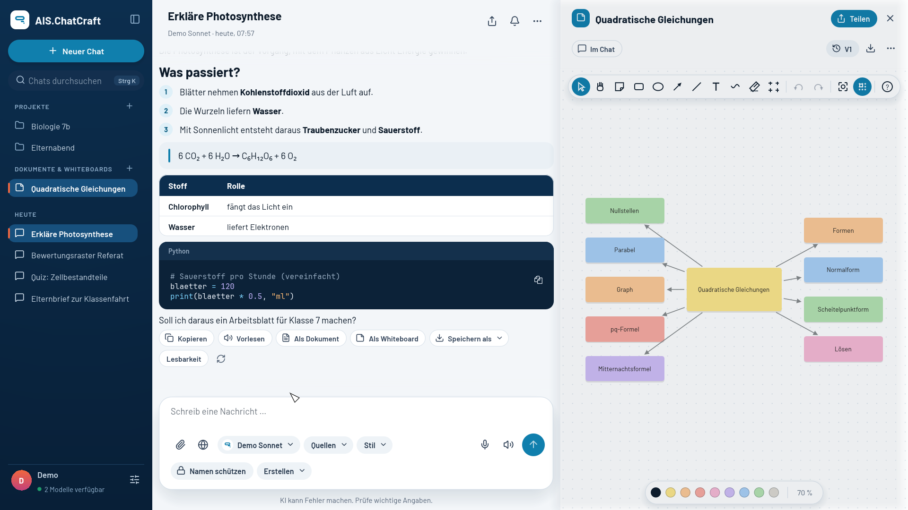
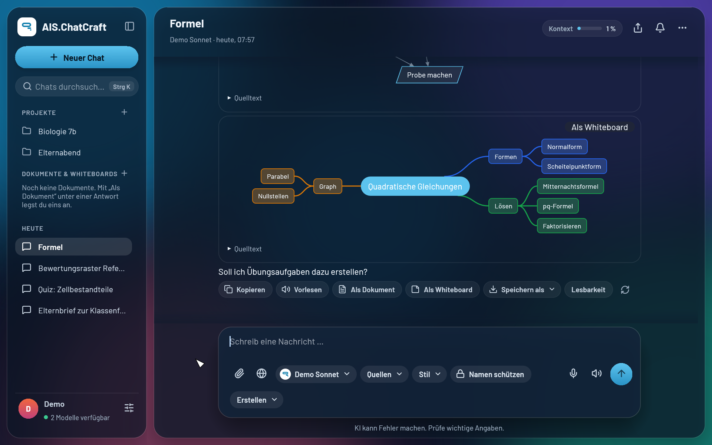

# AIS.ChatCraft

Ein Programm für den Rechner, mit dem Lehrkräfte mit [AIS.chat](https://app.ais-chat.schule) und anderen KI-Diensten arbeiten. Chats, Dokumente, Whiteboards und Arbeitsblätter liegen auf dem eigenen Rechner und sind durchsuchbar. Vor dem Senden kann das Programm Namen von Schülerinnen und Schülern durch Platzhalter ersetzen.

> **Community-Experiment.** AIS.ChatCraft ist kein offizielles Werkzeug des AIS.chat-Teams und kein Produkt des FWU. Es nutzt AIS.chat über die Web-App; Funktionen können sich ändern oder ausfallen.



Linux, macOS und Windows, geschrieben in Rust mit [egui](https://github.com/emilk/egui). Alle Bilder zeigen Demo-Daten.

## Was es kann

**Chatten**
- AIS.chat mit Assistenten, Dialogpartnern und Lernszenarien („Entdecken“, Favoriten). Daneben Claude, OpenAI-kompatible Dienste und lokale Modelle (Ollama, LM Studio).
- Fassungen beim Bearbeiten und Neu erzeugen, Antwortstile, „Nachgedacht“-Zusammenfassung, Diktieren, Vorlesen und Sprachmodus.
- Temporärer Chat, der nicht gespeichert wird.
- Schnelleingabe per Tastenkürzel des Desktops (`aiscraft --quick`).
- Vorlagen mit Feldern für wiederkehrende Aufgaben.

**Mit Antworten weiterarbeiten**
- Speichern als Word, PDF, Excel, Markdown oder Kalenderdatei (`.ics`), auf Wunsch mit dem Hinweis „Erstellt mit KI“.
- Dokumente und Whiteboards aus einer Antwort, mit Versionen und „Mit KI überarbeiten“, auch gemeinsam bearbeitbar.
- Formeln (LaTeX) und Diagramme (Mermaid) gezeichnet. Lesbarkeit (Flesch, LIX, Klassenstufe) und Link-Prüfung.
- Belege: Mit Claude zeigt ein Klick die Stelle in der Datei, die eine Aussage stützt.
- Recherche im Hintergrund mit Bericht und Quellenliste.

**Unterrichtsmaterial**
- Arbeitsblätter mit neun Aufgabentypen: am Rechner lösen, prüfen, als Arbeits- und Lösungsblatt drucken (mit Druckvorschau), Punkte an oder aus.
- Lern-Apps in einer einzigen HTML-Datei, abgeschottet in einem eigenen Vorschaufenster.
- H5P-Quiz als `.h5p` für Moodle, Mebis oder ByCS.



**Ordnen und finden**
- Volltextsuche über alle Chats, Strg+F im offenen Chat.
- Projekte mit eigenen Anweisungen und Dateien (Projektwissen).
- Gedächtnis nur aus den eigenen Worten.
- Quellen pro Chat: was ein Chat nutzen darf.

**Dateien für AIS.chat vorbereiten**
- `.doc`, `.ppt`, RTF, E-Mails und iPhone-Fotos werden auf dem Gerät umgewandelt.
- Nur ausgewählte Seiten, Blätter oder Folien senden.
- Standortdaten aus Fotos entfernen.

**Schützen und kontrollieren**
- „Namen schützen“: Namen aus der Klassenliste, E-Mail-Adressen, Telefonnummern, IBAN und Adressen gehen als Platzhalter raus und kommen in der Antwort lokal zurück. Über dem Eingabefeld steht, was das Gerät verlässt.
- Zugangsdaten im Schlüsselbund des Systems, nie in der Datenbank.
- Verbrauch und Token-Punkte, Monatsgrenze.



**Werkzeuge** (mit Claude oder OpenAI-kompatiblen Diensten)
- Konnektoren über MCP.
- Freigaben mit Vertrauensprüfung: Was nur liest, läuft; alles andere läuft nur auf Bitte oder nach einem Ja für genau diese Angaben.
- Eigene Regeln zum Erlauben und Verbieten.
- Aktionsprotokoll mit Begründung.
- Zeitpläne und Hintergrund-Aufgaben.
- Excel-, PowerPoint-, Word- und PDF-Dateien vom Modell.



**Aussehen:** „Modern“, „Glas“ und „Omarchy“ (nimmt die Farben des Desktops), jeweils hell, dunkel oder wie das System.



Das [Handbuch](crates/ui/manual/de.md) beschreibt jede Funktion; in der App öffnet es F1.

## Installieren

Fertige Pakete gibt es noch nicht; der Release-Workflow ist vorbereitet ([#58](https://github.com/FWU-DE/aiscraft/issues/58)). Bis dahin aus dem Quellcode:

```sh
git clone https://github.com/FWU-DE/aiscraft && cd aiscraft
packaging/install.sh      # Linux: baut und installiert für den eigenen Benutzer, ohne sudo
cargo run --release -p aiscraft   # oder direkt starten (alle Systeme)
```

Unter Linux braucht der Bau die Entwicklungspakete für X11/Wayland, GTK 3, ALSA und D-Bus; die Liste steht in [CONTRIBUTING.md](CONTRIBUTING.md). macOS und Windows brauchen nur [Rust](https://rustup.rs).

Danach unten links anmelden: AIS.chat über das Browserfenster (VIDIS, Schulkonto oder Microsoft 365), andere Dienste mit API-Schlüssel unter Einstellungen › Dienste.

## Für Skripte und Agenten

- `aiscraft-cli chat "Text"`, `status`, `search`, `export`, `call <befehl> '<json>'`
- `aiscraft-cli mcp`: alle Befehle als MCP-Server
- `aiscraft --control`: JSON-Steuerkanal auf 127.0.0.1

## Aufbau

| Pfad | Was |
|---|---|
| `apps/aiscraft` | die App |
| `apps/aiscraft-cli` | Kommandozeile und MCP-Server |
| `apps/aiscraft-preview` | abgeschottetes Vorschaufenster für Lern-Apps (wry) |
| `apps/aiscraft-collab-server` | Server für gemeinsames Bearbeiten |
| `crates/engine` | alle Befehle, Zustand, Datenschutz, Vertrauensprüfung |
| `crates/backends` | AIS.chat, Claude, OpenAI-kompatibel |
| `crates/ui` | Oberfläche (egui) und Handbuch |
| `crates/store` | SQLite-Datenbank mit Volltextsuche |
| `crates/board`, `crates/collab`, `crates/mcp`, `crates/voice`, `crates/rsc`, `crates/core` | Whiteboard, Zusammenarbeit, MCP-Client, Sprache, Next.js-RSC-Parser, gemeinsame Typen |

Regeln und Qualitätsschranken stehen in [AGENTS.md](AGENTS.md).

## Mitmachen

Fehler, Ideen und Code sind willkommen, siehe [CONTRIBUTING.md](CONTRIBUTING.md). Bitte keine Zugangsdaten oder Schülerdaten in Issues: Das Repository ist öffentlich. Sicherheitslücken über [GitHub Security Advisories](https://github.com/FWU-DE/aiscraft/security/advisories/new).

## Lizenz

[MIT](LICENSE-MIT) oder [Apache 2.0](LICENSE-APACHE), nach Wahl.

Ausnahme: die Vornamenliste für „Namen schützen“ (`crates/engine/src/privacy/vornamen.txt`) beruht auf den Vornamen der in Berlin geborenen Kinder, BerlinOnline GmbH auf Basis von Daten des LABO ([berlin/haeufige-vornamen-berlin](https://github.com/berlin/haeufige-vornamen-berlin)), unter [CC BY 3.0 DE](https://creativecommons.org/licenses/by/3.0/de/); bearbeitet (zusammengeführt, Wortnamen markiert, ergänzt).
