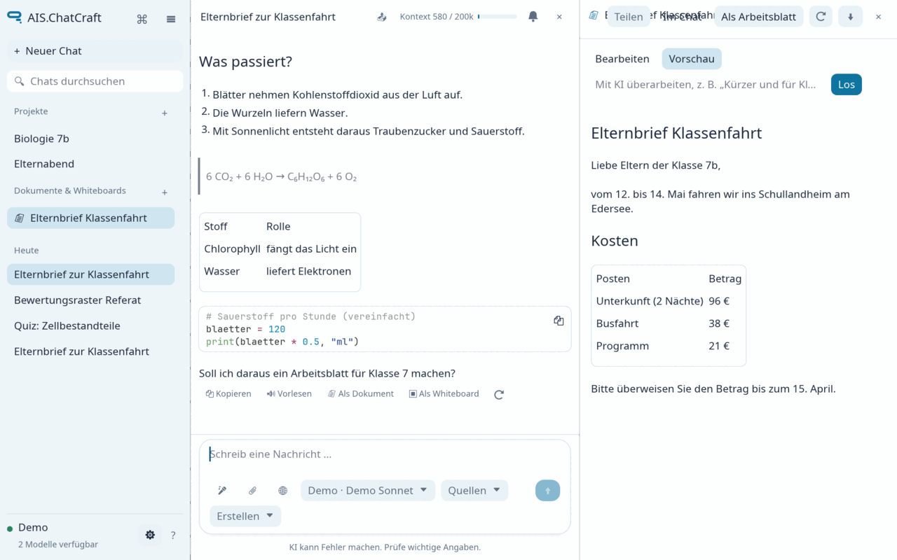
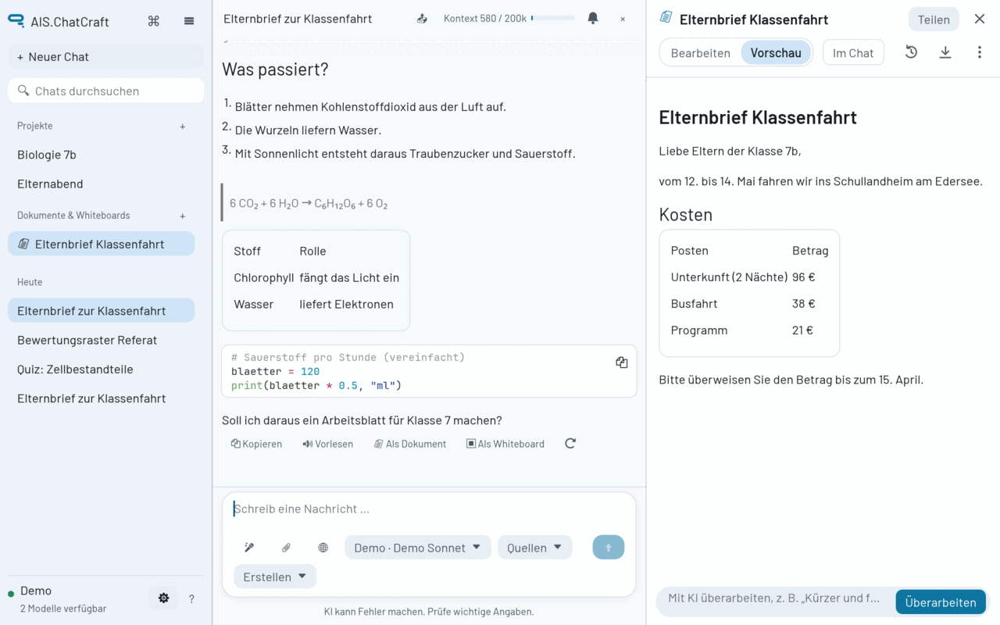
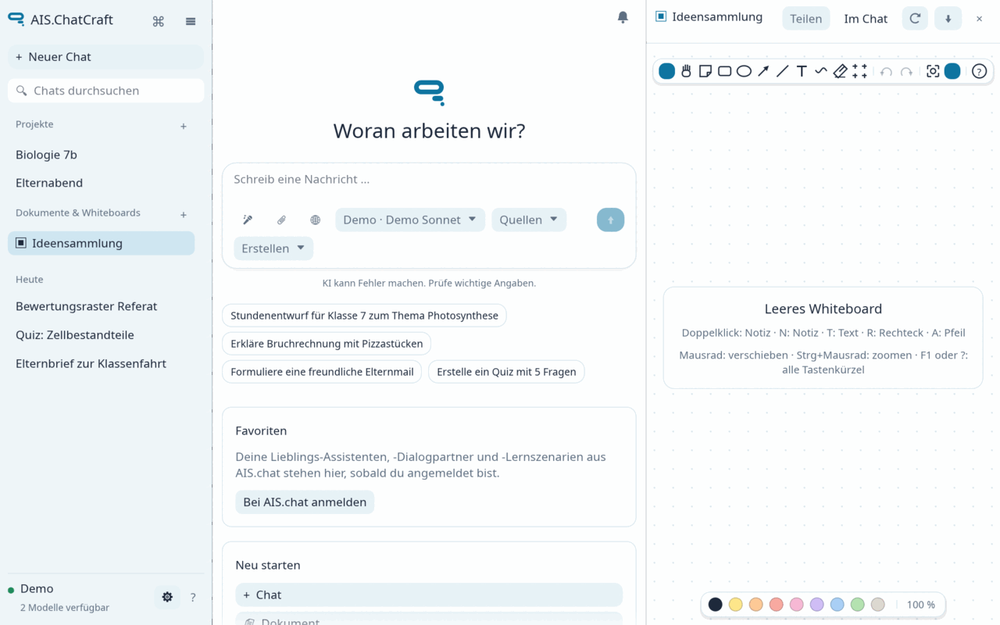
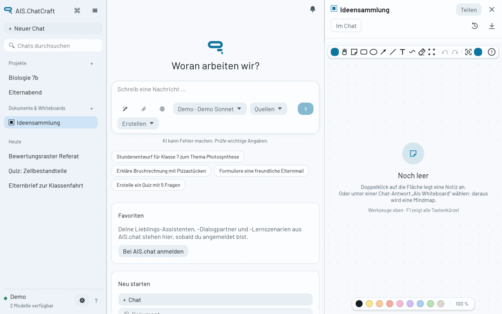
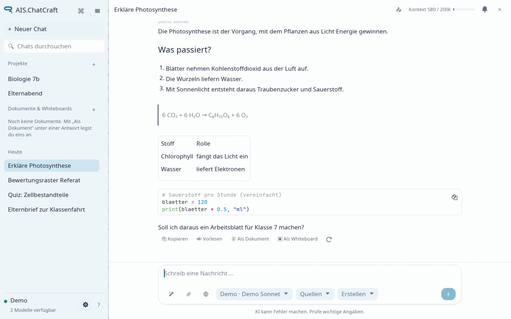
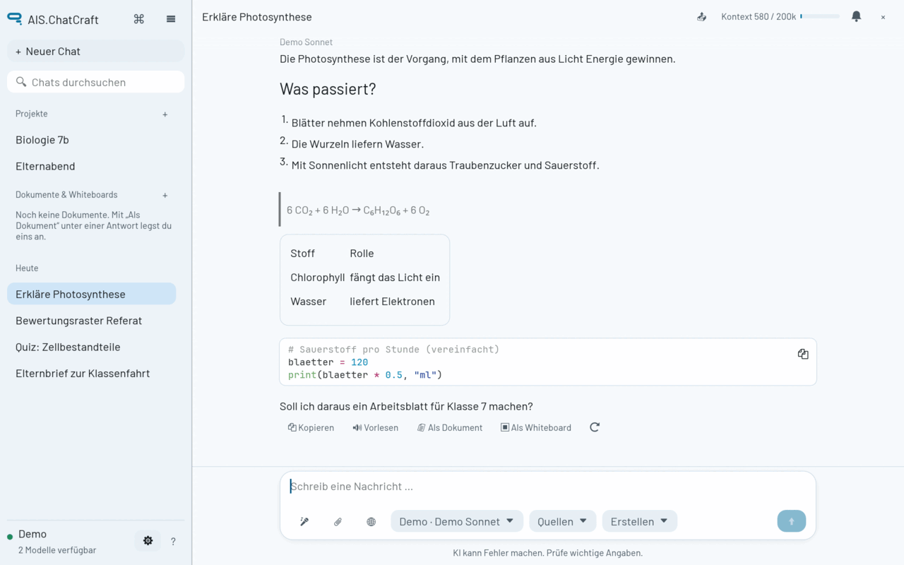
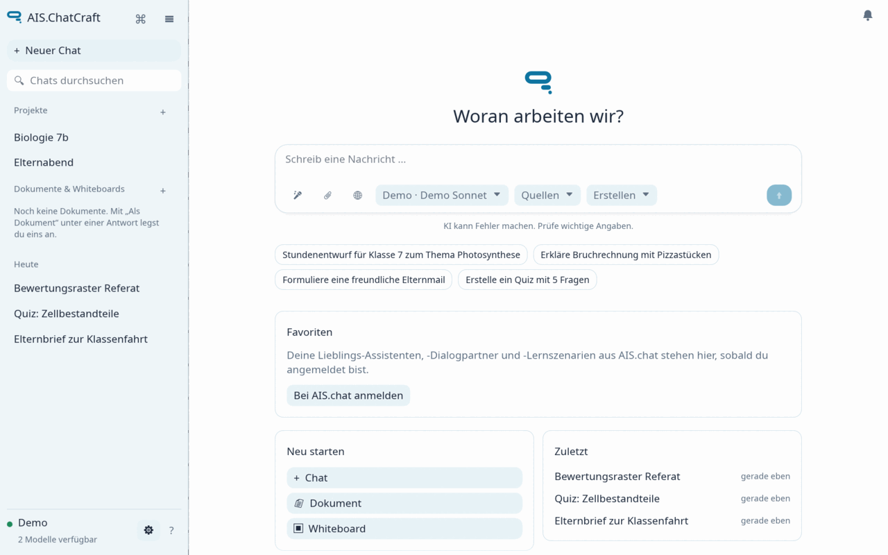
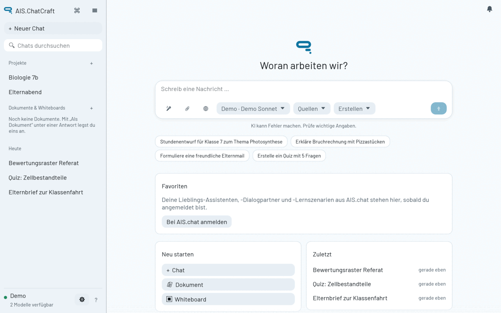
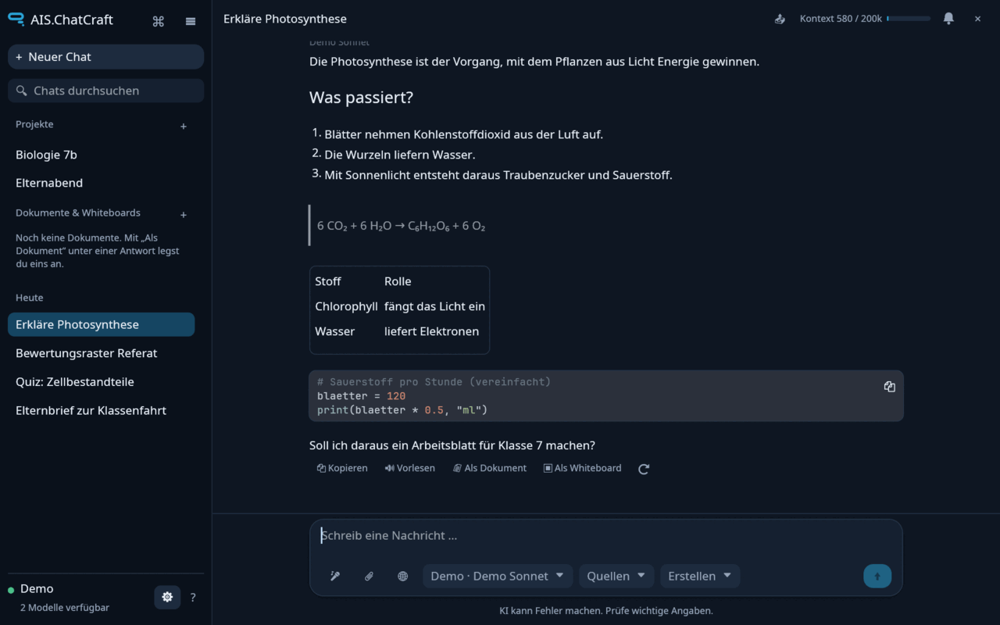
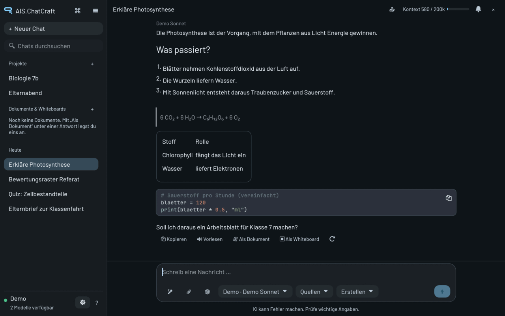

# Design-Review November 2026: Material 3 im AIS-Look

Stand: 24.11.2026, Branch `agent/design-proposal`. Prototyp zum Anschauen, nicht zum Mergen ohne
Entscheidungen (Abschnitt 6).

Ausgangspunkt: Die Oberfläche „sieht noch sehr spröde aus“. Ursachen, die beim Durchsehen auffallen:

- Alles ist gleich hell und gleich laut. Weiße Flächen, dünne Rahmen, eine Schrift in einer Stärke;
  Hierarchie entsteht fast nur über Größe.
- Symbole aus der Schrift (`×`, `⬇`, `⟳`) sind je nach Schrift winzig oder fehlen, und die Ziele
  sind kleiner als 32 px.
- Kopfzeilen laufen in schmalen Panels über: Im Artefakt-Panel überdecken die Knöpfe den Titel.
- Tabellen in Antworten sitzen eng im Rahmen, die Spalten kleben aneinander.

Vorschlag: **Material Design 3 als System**, mit der AIS-Farbe als Quelle der Tonpalette und Barlow
als Schrift. M3 passt zu egui, weil es wenige, klar benannte Rollen hat (Flächen, Container,
Zustandsebenen) statt vieler Einzelfarben.

## 1. Farbe: Tonpalette aus dem ais.schule-Blau

Quelle ist `#107fad` (ais.schule, Ton 50). Daraus die M3-Rollen (Hell / Dunkel):

| Rolle | Hell | Dunkel | Wofür |
|---|---|---|---|
| primary | `#0e74a0` (Ton 45, 5,0:1 auf surface) | `#83cffe` (P80) | Hauptknopf, Links, Fokus |
| on-primary | `#ffffff` | `#02344a` | Text auf primary |
| primary-container | `#c7e7fe` | `#024c6a` | eigene Nachricht, Hervorhebung |
| secondary-container | `#cfe5f7` | `#354957` | Auswahl (Seitenleiste, Segment, Chip) |
| surface | `#f7fafc` (N98) | `#0e1418` (N6) | Fensterhintergrund |
| surface-container-low | `#edf3f8` | `#171c20` | Seitenleiste |
| surface-container | `#e7eff5` | `#1b2025` | Eingabeleisten, Überarbeiten-Leiste |
| surface-container-lowest | `#ffffff` | `#1b2025` | Karten |
| on-surface / variant | `#171c20` / `#4a5863` | `#dce3e9` / `#bac8d4` | Text / Nebentext |
| outline-variant | `#d3dfe8` | `#3b4852` | Trennlinien, Tabellenrahmen |

Umgesetzt in `crates/ui/src/theme.rs` (`Tokens::light`, `Tokens::dark`, neue Felder
`primary_container`, `tertiary_container`, `surface_container`, `surface_highest`). Das
Omarchy-Thema leitet die neuen Rollen aus seinen Farben ab.

Wichtigste Wirkung: **Tonale Flächen statt Rahmen.** Seitenleiste, Karten und Eingabeleisten
unterscheiden sich durch den Ton, nicht durch 1-px-Linien. Menüs und Dialoge bekommen einen
weichen Schatten (M3 Elevation 2 und 3, angelehnt an `--shadow-dropdown` von AIS.chat) statt
eines Rahmens.

**Zustandsebenen:** Hover legt 8 %, Drücken 10 % der Textfarbe über die Fläche (vorher 8 / 14 %
plus Rahmen beim Hover). Das wirkt ruhiger und ist in Hell und Dunkel gleich.

## 2. Schrift: Barlow und eine Typo-Skala

Barlow ist die Schrift von AIS.chat und ais.schule und steht unter der SIL Open Font License 1.1.
Gebündelt sind Regular, Medium und SemiBold (zusammen rund 316 KB im Programm) mit
`crates/ui/assets/fonts/OFL.txt`. Noto Sans und DejaVu bleiben als Rückfall für Zeichen, die
Barlow fehlt (₂, Griechisch, Pfeile).

Typo-Skala nach M3, auf Barlow abgestimmt:

| Stil | Vorher | Jetzt |
|---|---|---|
| Body (Body large) | 15 px Noto | 16 px Barlow Regular |
| Button (Label large) | 14 px | 14,5 px Barlow Medium |
| Small (Body small) | 12 px | 13 px |
| Heading (Headline small) | 22 px | 24 px Barlow SemiBold |

egui kennt keine Schriftstärken, nur Familien. Deshalb gibt es die Familien `medium` und
`semibold` und die Helfer `theme::medium()` und `theme::semibold()` (Titel im Artefakt-Panel,
gewähltes Segment, aktiver Chip).

Grenze: In Markdown-Antworten macht egui_commonmark **fett** nur über die Farbe, und
Überschriften ab H2 haben dieselbe Stärke wie der Text. Echte Stärken brauchen einen kleinen
Patch an egui_commonmark (`strong` und H1–H3 in der Familie `semibold`, Zeilenhöhe 1,5 im
Fließtext). Ein früherer Versuch hat das Crate dafür ins Repo kopiert; das ist wieder raus. Besser
als Pull Request an das storytold-Fork bzw. upstream, siehe Entscheidung E4.

## 3. Formen und Abstände

- Bedienelemente: Radius 10 (vorher 8), Höhe 30 px (vorher 26), Innenabstand 12 × 6.
- Karten 12, Dialoge 16, Eingabe-Pillen 22 (M3 „full“ bei dieser Höhe).
- Menüränder 8 px.

## 4. Die drei offenen Punkte aus dem Review

### (6) Kopfzeile des Artefakt-Panels

Vorher: eine Zeile, Knöpfe von rechts nach links, die bei schmalem Panel über den Titel laufen
(„Teilen“ und „Im Chat“ liegen auf „Elternbrief“). Das Schließen-× ist ein 15-px-Schriftzeichen,
`⬇` und `⟳` sind ohne Hover kaum als Knopf zu erkennen.

Jetzt, zwei Zeilen nach M3 „Top app bar“:

1. Typ-Symbol, Titel in SemiBold (kürzt mit …, Doppelklick benennt um), rechts „Teilen“ und
   Schließen.
2. Werkzeugzeile: Segmentknopf Bearbeiten | Vorschau (nur Dokumente), Filter-Chip „Im Chat“,
   rechts Versionen, Exportieren und ein Überlaufmenü (⋮) mit „Als Arbeitsblatt“.

Die Symbole sind gezeichnet (`widgets::glyph_button`, `Glyph::{Close, Download, History, More}`),
36-px-Ziel, runde Zustandsebene, Name als Tooltip und als Bedienhilfen-Name. Damit fällt auch
die Abhängigkeit von Systemschriften für diese Zeichen weg.

| Vorher | Nachher |
|---|---|
|  |  |

### (7) Überarbeiten-Feld und leeres Whiteboard

**„Los“-Feld:** Das Feld „Mit KI überarbeiten“ stand über dem Dokument, zwischen Umschalter und
Text, und der Knopf hieß „Los“. Jetzt steht es **unter** dem Inhalt, gestaltet wie die
Chat-Eingabe (tonale Pille, rahmenloses Feld), der Knopf heißt **„Überarbeiten“**. Dokumente,
Lern-Apps und Arbeitsblätter teilen sich dieselbe Leiste (`revise_bar`); die doppelte Fassung im
Dokument-Panel ist entfernt. Beim Absenden springt das Dokument wie bisher in die Vorschau.

**Leeres Whiteboard:** Vorher eine gerahmte Karte mit zwei Zeilen Tastenkürzeln. Jetzt ein
M3-Leerzustand: Notiz-Symbol im tonalen Kreis, „Noch leer“, ein Satz zum schnellsten Start
(Doppelklick legt eine Notiz an) und woher Mindmaps kommen („Als Whiteboard“ unter einer
Antwort). Die Kürzel stehen weiter hinter F1.

| Vorher | Nachher |
|---|---|
|  |  |

Nächster Schritt (nicht umgesetzt, E5): Im Leerzustand zwei klickbare Starter, „Notiz anlegen“
und „Mindmap aus dem letzten Chat“.

### (18) Tabellen in Antworten

egui_commonmark zeichnet Tabellen als Raster in `Frame::group` mit 6 px Rand und dem normalen
Elementabstand von 8 px; die Spalten kleben aneinander. Ohne das Crate anzufassen:
`markup::table_pieces` trennt GFM-Tabellen (außerhalb von Code-Blöcken) aus dem Markdown. Sie
werden dann mit 28 px Spaltenabstand gezeichnet, im eigenen Kartenrahmen (Radius 12, 14 px
Innenrand) und mit Abstand zum folgenden Absatz. Ein Test deckt Tabellen, Code-Blöcke und
„Pipe ohne Trennzeile“ ab.

Offen bleibt die Kopfzeile in SemiBold und eine Hintergrundfarbe dafür; das geht nur im Crate (E4).

| Vorher | Nachher |
|---|---|
|  |  |

## 5. Gesamteindruck

| Vorher | Nachher |
|---|---|
|  |  |
|  |  |

Die Bilder entstehen offscreen mit dem Snapshot-Beispiel (`crates/ui/examples/snapshot.rs`,
1280 × 800, Faktor 1,5, auf 1280 px Breite verkleinert). Dabei ist ein Fehler im Demo-Server
behoben: Er gab für jede Frage die Formel-Antwort, weil er „Formel“ in der ganzen Anfrage samt
Systemprompt suchte statt in der Nachricht.

## 6. Entscheidungen für den Owner

| | Frage | Empfehlung |
|---|---|---|
| E1 | **Barlow ja oder nein?** Bündeln (316 KB, OFL-Lizenzdatei liegt bei) oder bei der Systemschrift bleiben. | Ja: gleiche Schrift wie AIS.chat, wirkt sofort weniger technisch. |
| E2 | **Dunkles Thema:** neutrale M3-Töne (Grau mit einem Hauch Blau, wie im Prototyp) oder das bisherige Nachtblau. | Nachtblau als Fläche behalten, M3-Rollen darauf ableiten; das Grau wirkt fremder als das Blau von AIS.chat. Der Senden-Knopf in P80 wirkt im Dunkeln deaktiviert. |
| E3 | **Hintergrund hell:** leicht getöntes `#f7fafc` statt reinem Weiß, Karten weiß. | Ja, sonst trägt die tonale Staffelung nicht. |
| E4 | **egui_commonmark patchen** für echtes Fett, H2–H4 in SemiBold, Tabellenkopf: als PR ans storytold-Fork (wie bei egui), nicht ins Repo kopiert. | Ja, PR am Fork; bis dahin bleibt die Lösung aus 4 (18). |
| E5 | Leeres Whiteboard mit klickbaren Startern (braucht Interaktion im `board`-Widget). | Ja, als eigenes Issue. |
| E6 | Überlaufmenü (⋮) in der Artefakt-Kopfzeile: „Als Arbeitsblatt“ dorthin verschieben ist für Lehrkräfte versteckter. | Beobachten; falls oft gebraucht, als Knopf unter dem Dokument neben „Überarbeiten“. |
| E7 | M3-Muster auf den Rest übertragen: Chat-Kopfzeile (dort ist das × ebenfalls winzig), Nachrichtenaktionen, Einstellungen. | Ja, nach E1–E3, in kleinen Schritten mit Screenshots. |

## 7. Geänderte Dateien

- `crates/ui/src/theme.rs`: Tonpalette, Zustandsebenen, Schatten, Typo-Skala, Barlow.
- `crates/ui/assets/fonts/`: Barlow Regular, Medium, SemiBold, `OFL.txt`.
- `crates/ui/src/widgets.rs`: `glyph_button`, `segmented`, `filter_chip`.
- `crates/ui/src/artifact_panel.rs`: zweizeilige Kopfzeile, Überarbeiten-Leiste unten.
- `crates/ui/src/learn_panel.rs`: `revise_bar` als Leiste unter dem Inhalt.
- `crates/ui/src/markup.rs`: Tabellen mit mehr Luft (`table_pieces`).
- `crates/board/src/view.rs`: Leerzustand des Whiteboards.
- `crates/ui/examples/snapshot.rs`: Demo-Antwort nach der Nachricht wählen.
